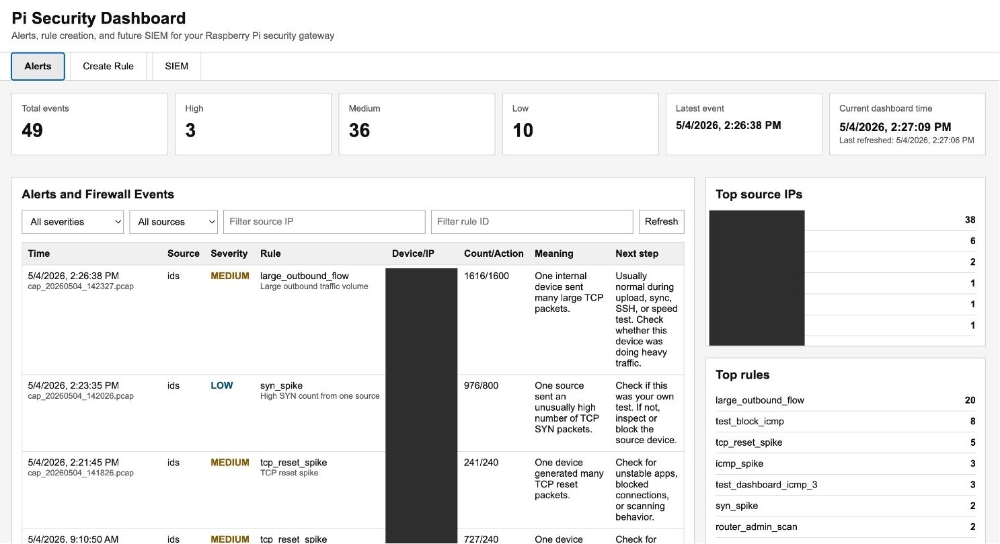
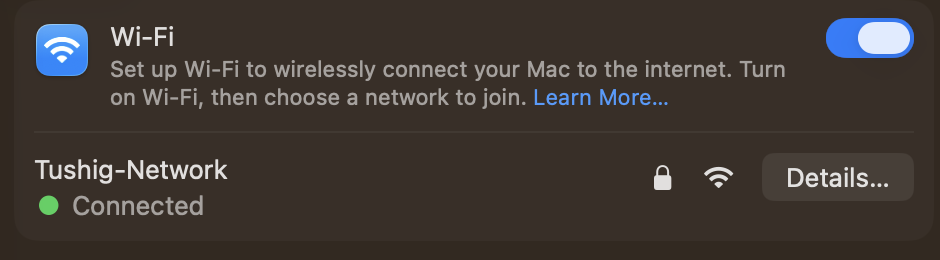
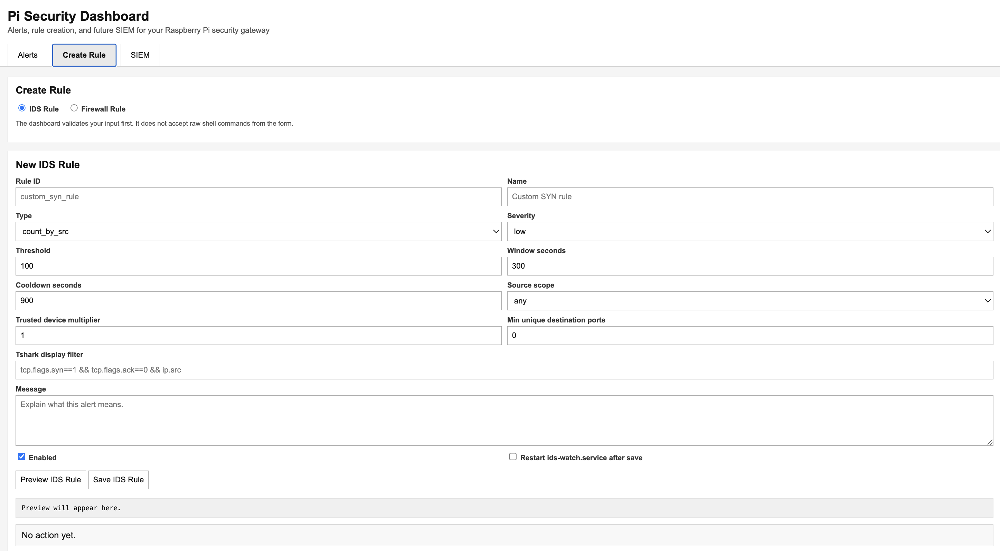
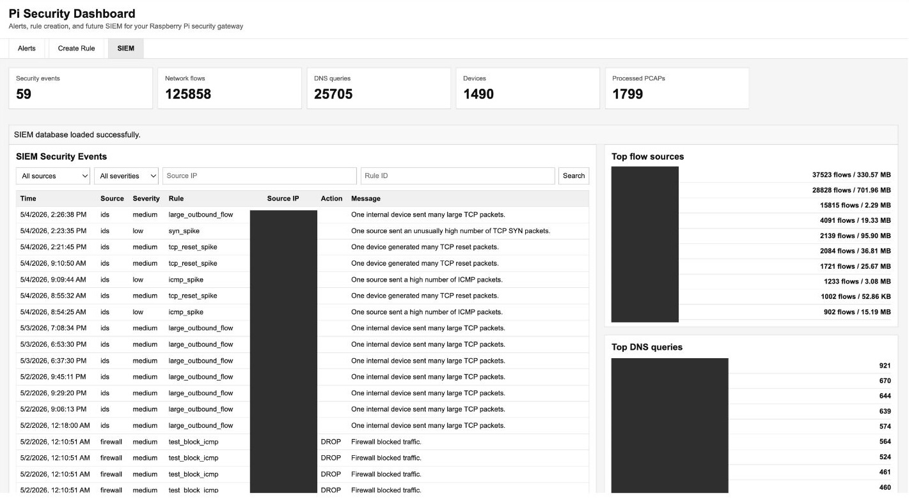
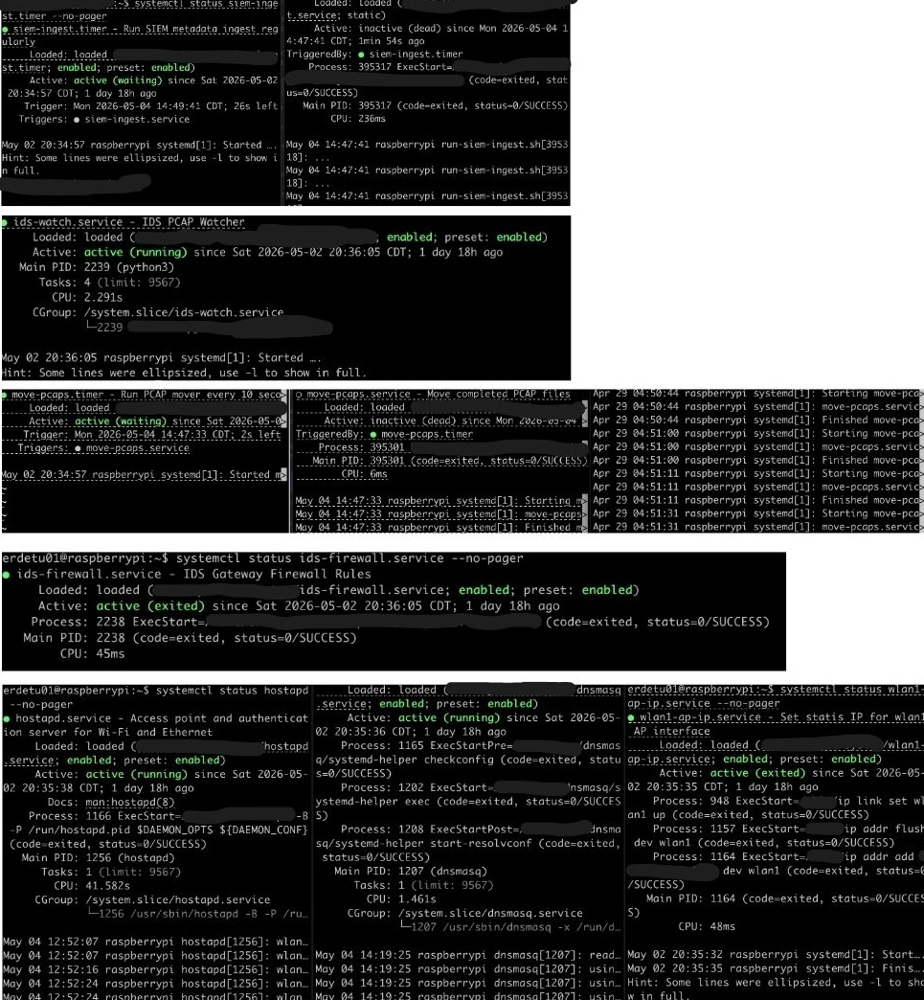

# PiSec Lab v3: Raspberry Pi Security Gateway

A Raspberry Pi that runs its own Wi-Fi network, captures every packet from the devices on it, checks the traffic against my own detection rules, and shows the alerts on a web dashboard. Old packet captures are turned into searchable records in a small SQLite SIEM and then deleted to save space.

All IPs, usernames, hostnames, MAC addresses and paths in this repo are anonymized.



## At a Glance

| | |
|---|---|
| Hardware | Raspberry Pi as Wi-Fi access point, router and sensor |
| Capture | tcpdump, new PCAP file every 60 seconds |
| Detection | Custom Python engine, 16 YAML rules, parsed with TShark |
| Alerts | JSON Lines file + FastAPI web dashboard |
| Storage | SQLite mini-SIEM (flows, DNS queries, devices, security events) |
| Automation | systemd services and timers, runs 24/7 |
| Remote access | Dashboard reachable only through Tailscale |

At the time of the SIEM screenshot below, it had processed **1,799 PCAP files** into **125,858 network flows** and **25,705 DNS queries**.

## How It Works

```text
Devices on Pi Wi-Fi
      |
      v
tcpdump  -->  pcaps_capture/      (new file every 60 s)
      |
      v
mover timer  -->  pcaps_in/       (only finished files)
      |
      v
ids_watch_v3.py + rules_v3.yaml   (TShark parses, rules check)
      |
      +-->  alert.jsonl  -->  dashboard
      |
      v
pcaps_archive/  -->  pcap_to_siem.py  -->  siem.db  -->  PCAP deleted
```

## Folder Layout

```text
v3/
  src/
    ids_watch_v3.py    watches for new PCAPs and runs the rules
    dashboard.py       FastAPI dashboard (alerts, rule creation, SIEM view)
    pcap_to_siem.py    turns archived PCAPs into SQLite records
  rules/
    rules_v3.yaml      the 16 detection rules
  images/              screenshots
```

## The Gateway

The Pi creates its own Wi-Fi network, and the devices I want to monitor join it. All their traffic passes through the Pi.

| Service | Job |
|---|---|
| hostapd | Runs the Wi-Fi access point |
| dnsmasq | Hands out IPs (DHCP) and answers DNS |
| Linux routing + iptables | Forwards traffic to the internet and applies firewall rules |
| tcpdump | Captures the traffic |



## Detection Rules

Every rule lives in `rules/rules_v3.yaml`. Each one has a threshold, a time window and a cooldown so the same event does not alert over and over.

| Rule | What it catches | Severity |
|---|---|---|
| ssh_scan | Many connection attempts to SSH (22) | Medium |
| rdp_scan | Attempts on Remote Desktop (3389) | High |
| smb_scan | Attempts on SMB file sharing (445) | High |
| telnet_scan | Attempts on Telnet (23) | High |
| adb_scan | Probes on Android Debug Bridge (5555) | High |
| docker_api_scan | Probes on the Docker API (2375) | High |
| router_admin_scan | Probes on router admin ports | Medium |
| internal_port_scan | An inside device hitting many ports | Medium |
| external_sensitive_port_scan | An outside source hitting sensitive ports | High |
| syn_spike | Unusually high TCP SYN count | Low |
| icmp_spike | Unusually high ping traffic | Low |
| dns_dynamic_dns_watch | Lookups of dynamic DNS domains (duckdns, no-ip) | Medium |
| dns_tunnel_or_remote_access_watch | Lookups of tunneling services (ngrok, trycloudflare) | High |
| dns_nxdomain_spike | Many failed DNS lookups | Medium |
| large_outbound_flow | An inside device sending a lot of data out | Medium |
| tcp_reset_spike | Many TCP resets | Medium |

### Cutting false positives

My own laptop and phone upload files, sync and run SSH all the time, which kept tripping the rules. So the rules file lists **trusted devices**, and most rules have a `trusted_device_multiplier`. For a trusted device the threshold is doubled. Unknown devices are watched at the normal, stricter level.

Rules can also be limited to inside or outside sources (`src_scope`) and can require a minimum number of different ports before alerting (`min_unique_dst_ports`).

## Dashboard

Built with FastAPI and runs on the Pi. Three tabs:

| Tab | What it does |
|---|---|
| Alerts | Counts by severity, alert table with filters, top source IPs and top rules, plus a plain English "meaning" and "next step" for each alert |
| Create Rule | Form to add an IDS rule or a firewall rule. Input is validated, and no raw shell commands are accepted. Firewall rules are turned into iptables rules by the backend |
| SIEM | Search security events, top flow sources and top DNS queries from the database |





## Mini-SIEM

`pcap_to_siem.py` reads each archived PCAP and saves only the useful metadata, then deletes the PCAP. It checks that the file is readable before deleting anything.

| Table | Holds |
|---|---|
| security_events | IDS alerts and firewall events |
| network_flows | Who talked to whom, ports, packets, bytes |
| dns_queries | Every DNS lookup and its result |
| devices | IP, MAC and hostname (from DHCP leases and traffic) |
| processed_pcaps | Which files were already imported |

## Automation

| Unit | Job |
|---|---|
| move-pcaps.timer | Every 10 seconds, moves finished PCAPs to the IDS folder |
| ids-watch.service | Runs the IDS engine all the time |
| ids-dashboard.service | Runs the dashboard |
| siem-ingest.timer | Regularly imports archived PCAPs into SQLite |
| ids-firewall.service | Applies the firewall rules at boot |



## Running It

```bash
# start everything
sudo systemctl restart ids-firewall.service move-pcaps.timer ids-watch.service siem-ingest.timer ids-dashboard.service

# start capture
sudo tcpdump -i <wifi_interface> -n -s 96 -w /path/to/project/pcaps_capture/cap_%Y%m%d_%H%M%S.pcap -G 60

# watch alerts live
tail -f /path/to/project/ids_alerts/alert.jsonl

# check the database
sqlite3 /path/to/project/siem/siem.db ".tables"
```

## What I Learned

Writing the rules was the easy part. Most of the work was making the pipeline reliable: not reading a PCAP while it is still being written, keeping storage from filling up, tuning noisy rules, validating dashboard input, and getting systemd services and timers to recover on their own. I also learned firewall rule order the hard way: an inserted rule and an appended rule behave very differently when a broad allow rule is already in place.

## Next Steps

1. Log firewall drops and send them to the dashboard
2. Better detection of new, unknown devices
3. Timeline view for alerts and flows
4. Enable and disable rules from the dashboard
5. Configurable PCAP retention

This is a working personal prototype for learning, not a production security product.
